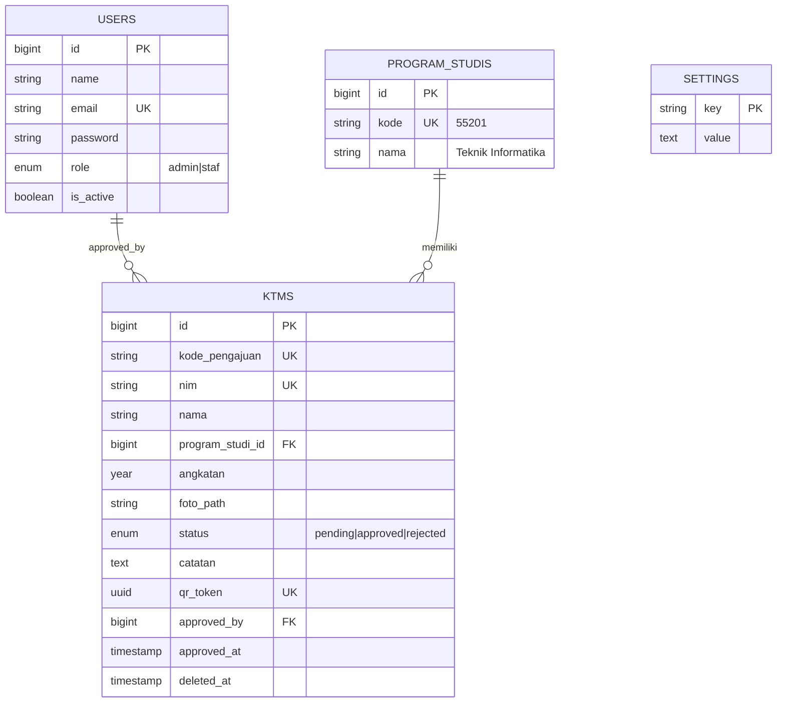

# KTM Generator — STMIK Adhi Guna

> Spesifikasi & panduan implementasi aplikasi pembuat **Kartu Tanda Mahasiswa (KTM)**.
> Stack: **Laravel 11 + MySQL + Blade + Tailwind + Alpine.js**. Render kartu: **HTML/CSS → PDF (dompdf)** dan **PNG**.

---

## 1. Ringkasan

Aplikasi web dengan alur:

1. Mahasiswa mengisi **formulir KTM** (nama, NIM, program studi, angkatan, foto).
2. Data tersimpan di database dengan status `pending`.
3. **Admin** login ke dashboard, mengelola:
   - **Data KTM** — verifikasi, edit, preview kartu, unduh PDF/PNG, hapus.
   - **Data User** — kelola akun pengguna dashboard (admin/staf).
4. KTM yang disetujui dapat dicetak (ukuran CR80) lengkap dengan QR code verifikasi.

### Analisis desain kartu (dari gambar)

**Sisi depan**

| Elemen | Isi contoh | Sumber data |
|---|---|---|
| Logo + nama kampus | STMIK ADHI GUNA | Setting (statis) |
| Foto | Pas foto, background merah, sudut membulat | Upload form |
| Label | KARTU MAHASISWA | Statis |
| Nama | FARDIANSYAH | Form (uppercase) |
| NIM | 5520123026 | Form |
| Program studi | TEKNIK INFORMATIKA | Form / master prodi (uppercase) |
| QR code (kanan bawah) | Link verifikasi | Digenerate |
| Latar | Gradasi biru muda, gelombang biru & garis merah | Asset (CSS/SVG) |

**Sisi belakang**

| Elemen | Isi | Sumber data |
|---|---|---|
| Judul "PERHATIAN" + 3 poin tata tertib | Teks statis | Setting |
| QR code (kiri bawah) | Logo kampus di tengah | Digenerate |
| Ketua + stempel + tanda tangan | Hj. Mus Aidah, S.Pd., MM. — NIDN 0918127802 | Setting (upload TTD & stempel) |

> **Angkatan:** pada kartu contoh angkatan tidak dicetak, tetapi diminta pada formulir. Angkatan disimpan sebagai data dan dapat (opsional) dicetak di kartu, mis. di bawah program studi.
>
> **Asumsi struktur NIM** (`5520123026`): `55201` = kode prodi, `23` = tahun masuk (2023), `026` = no. urut. Form otomatis **menyarankan** angkatan dari digit ke-6–7 NIM, tetapi tetap bisa diedit user. Mohon verifikasi pola ini dengan bagian akademik kampus.

---

## 2. Fitur

### 2.1 Publik
- Formulir KTM dengan validasi client + server.
- Pratinjau KTM langsung (live preview) saat mengetik.
- Crop/resize foto 3:4 sebelum upload.
- Halaman sukses + kode pengajuan.
- Halaman **verifikasi QR** `/verifikasi/{token}` — menampilkan nama, NIM, prodi, angkatan, status (tanpa foto penuh / data sensitif).

### 2.2 Dashboard Admin
- Login, logout, lupa password.
- **Dashboard:** total pengajuan, pending, disetujui, ditolak, grafik per angkatan/prodi.
- **Data KTM:** tabel (search, filter status/prodi/angkatan, sort, pagination), tambah manual, edit, detail, preview kartu depan-belakang, setujui/tolak (dengan catatan), unduh PDF/PNG, cetak massal, hapus (soft delete), ekspor Excel.
- **Data User:** CRUD akun, role (`admin`, `staf`), aktif/nonaktif, reset password.
- **Pengaturan:** nama kampus, logo, nama ketua, NIDN, TTD, stempel, teks tata tertib.

### 2.3 Hak akses

| Aksi | admin | staf |
|---|:-:|:-:|
| Lihat/ubah Data KTM | ✅ | ✅ |
| Setujui / tolak KTM | ✅ | ✅ |
| Hapus KTM | ✅ | ❌ |
| Kelola Data User | ✅ | ❌ |
| Pengaturan | ✅ | ❌ |

---

## 3. Arsitektur & Stack

| Lapisan | Pilihan |
|---|---|
| Framework | Laravel 11 (PHP 8.2+) |
| Auth dashboard | Laravel Breeze (Blade) |
| DB | MySQL 8 / MariaDB |
| UI | Tailwind CSS + Alpine.js |
| Tabel data | Livewire 3 *atau* Blade + query string (pilih satu; Blade lebih sederhana) |
| Upload & gambar | Intervention Image v3 |
| QR code | `simplesoftwareio/simple-qrcode` |
| PDF | `barryvdh/laravel-dompdf` |
| PNG | `spatie/browsershot` *(opsional)* atau `html2canvas` di client |
| Excel | `maatwebsite/excel` |
| Otorisasi | Gate/Policy bawaan Laravel |
| Testing | Pest / PHPUnit |

### Struktur folder (ringkas)

```
app/
 ├─ Http/
 │   ├─ Controllers/
 │   │   ├─ KtmFormController.php          # publik
 │   │   ├─ VerifikasiController.php       # publik
 │   │   └─ Admin/
 │   │       ├─ DashboardController.php
 │   │       ├─ KtmController.php
 │   │       ├─ UserController.php
 │   │       └─ SettingController.php
 │   ├─ Requests/ (StoreKtmRequest, UpdateKtmRequest, StoreUserRequest, ...)
 │   └─ Middleware/EnsureUserIsActive.php
 ├─ Models/ (Ktm, User, ProgramStudi, Setting)
 ├─ Policies/ (KtmPolicy, UserPolicy)
 └─ Services/
     ├─ KtmImageService.php                # proses foto
     ├─ KtmRenderService.php               # render PDF/PNG
     └─ AngkatanResolver.php               # saran angkatan dari NIM
resources/views/
 ├─ ktm/form.blade.php, sukses.blade.php
 ├─ verifikasi.blade.php
 ├─ admin/{dashboard, ktm/*, users/*, settings}.blade.php
 └─ ktm/card/{front, back, pdf}.blade.php  # template kartu
```

---

## 4. Model Data (ERD)



### Migrations

```php
// create_program_studis_table
Schema::create('program_studis', function (Blueprint $t) {
    $t->id();
    $t->string('kode', 10)->unique();
    $t->string('nama');
    $t->timestamps();
});

// create_ktms_table
Schema::create('ktms', function (Blueprint $t) {
    $t->id();
    $t->string('kode_pengajuan', 20)->unique();
    $t->string('nim', 20)->unique();
    $t->string('nama', 100);
    $t->foreignId('program_studi_id')->constrained()->restrictOnDelete();
    $t->unsignedSmallInteger('angkatan')->index();
    $t->string('foto_path');
    $t->enum('status', ['pending', 'approved', 'rejected'])->default('pending')->index();
    $t->text('catatan')->nullable();
    $t->uuid('qr_token')->unique();
    $t->foreignId('approved_by')->nullable()->constrained('users')->nullOnDelete();
    $t->timestamp('approved_at')->nullable();
    $t->softDeletes();
    $t->timestamps();
});

// add_role_to_users_table
Schema::table('users', function (Blueprint $t) {
    $t->enum('role', ['admin', 'staf'])->default('staf')->after('password');
    $t->boolean('is_active')->default(true)->after('role');
});

// create_settings_table
Schema::create('settings', function (Blueprint $t) {
    $t->string('key')->primary();
    $t->text('value')->nullable();
    $t->timestamps();
});
```

**Seeder awal:** 1 admin, master prodi (mis. `55201 Teknik Informatika`, tambah sesuai kampus), setting default (nama ketua `Hj. Mus Aidah, S.Pd., MM.`, NIDN `0918127802`, teks tata tertib).

---

## 5. Routing

```php
// routes/web.php

// ---- Publik
Route::get('/', [KtmFormController::class, 'create'])->name('ktm.form');
Route::post('/ajukan', [KtmFormController::class, 'store'])
    ->middleware('throttle:5,1')->name('ktm.store');
Route::get('/sukses/{kode}', [KtmFormController::class, 'sukses'])->name('ktm.sukses');
Route::get('/verifikasi/{token}', VerifikasiController::class)->name('ktm.verifikasi');

// ---- Admin
Route::middleware(['auth', 'active'])->prefix('admin')->name('admin.')->group(function () {
    Route::get('/', DashboardController::class)->name('dashboard');

    Route::resource('ktm', Admin\KtmController::class);
    Route::post('ktm/{ktm}/approve', [Admin\KtmController::class, 'approve'])->name('ktm.approve');
    Route::post('ktm/{ktm}/reject',  [Admin\KtmController::class, 'reject'])->name('ktm.reject');
    Route::get('ktm/{ktm}/pdf',      [Admin\KtmController::class, 'pdf'])->name('ktm.pdf');
    Route::get('ktm/{ktm}/png',      [Admin\KtmController::class, 'png'])->name('ktm.png');
    Route::post('ktm/bulk-pdf',      [Admin\KtmController::class, 'bulkPdf'])->name('ktm.bulk-pdf');
    Route::get('ktm-export',         [Admin\KtmController::class, 'export'])->name('ktm.export');

    Route::middleware('can:admin')->group(function () {
        Route::resource('users', Admin\UserController::class)->except('show');
        Route::get('pengaturan',  [Admin\SettingController::class, 'edit'])->name('settings.edit');
        Route::put('pengaturan',  [Admin\SettingController::class, 'update'])->name('settings.update');
    });
});
```

---

## 6. Formulir KTM

### Field

| Field | Tipe | Validasi |
|---|---|---|
| `nama` | text | required, max 100, huruf/spasi/titik/apostrof |
| `nim` | text | required, digit, 8–12 karakter, **unique** di `ktms` |
| `program_studi_id` | select | required, exists |
| `angkatan` | select (tahun) | required, 2000 s.d. tahun berjalan |
| `foto` | file | required, image, mimes jpg/png, max 2 MB, min 300×400 px |

### FormRequest

```php
class StoreKtmRequest extends FormRequest
{
    public function authorize(): bool { return true; }

    protected function prepareForValidation(): void
    {
        $this->merge([
            'nama' => Str::of($this->nama)->squish()->upper()->toString(),
            'nim'  => preg_replace('/\D/', '', (string) $this->nim),
        ]);
    }

    public function rules(): array
    {
        return [
            'nama' => ['required', 'string', 'max:100', "regex:/^[\pL\s.\'-]+$/u"],
            'nim'  => ['required', 'digits_between:8,12', 'unique:ktms,nim'],
            'program_studi_id' => ['required', 'exists:program_studis,id'],
            'angkatan' => ['required', 'integer', 'between:2000,' . now()->year],
            'foto' => ['required', 'image', 'mimes:jpg,jpeg,png', 'max:2048',
                       'dimensions:min_width=300,min_height=400'],
        ];
    }
}
```

### Controller

```php
public function store(StoreKtmRequest $request, KtmImageService $img)
{
    $ktm = Ktm::create([
        ...$request->safe()->except('foto'),
        'kode_pengajuan' => 'KTM-' . now()->format('ymd') . '-' . Str::upper(Str::random(5)),
        'qr_token'       => (string) Str::uuid(),
        'foto_path'      => $img->store($request->file('foto')),
    ]);

    return redirect()->route('ktm.sukses', $ktm->kode_pengajuan);
}
```

### Service foto

```php
class KtmImageService
{
    public function store(UploadedFile $file): string
    {
        $image = Image::read($file)->cover(354, 472);   // 3:4, ±3×4 cm @300dpi
        $path  = 'ktm/foto/' . Str::uuid() . '.jpg';
        Storage::disk('local')->put($path, (string) $image->toJpeg(85)); // re-encode = hapus metadata/payload berbahaya
        return $path;
    }
}
```

> Simpan foto di disk **private** (`storage/app`), tampilkan lewat route ber-otorisasi — foto mahasiswa adalah data pribadi.

### Live preview

Komponen Alpine.js di `form.blade.php` yang mengikat input ke template kartu (nama, NIM, prodi, foto via `URL.createObjectURL`). Angkatan otomatis disarankan:

```js
// NIM 5520123026 → digit ke-6 & 7 = "23" → 2023
const guess = nim.length >= 7 ? 2000 + parseInt(nim.substr(5, 2)) : null;
```

---

## 7. Template Kartu (render)

**Ukuran:** CR80 = **85.6 × 54 mm**, landscape. Gunakan satuan `mm` di CSS agar cetak presisi.

### Aturan desain
- Background depan/belakang: **SVG/PNG asset** (`public/assets/ktm/bg-front.svg`, `bg-back.svg`) berisi gradasi + gelombang + garis merah, agar render konsisten di dompdf (dompdf lemah di gradient/clip-path kompleks).
- Font: Lato (label ber-letter-spacing) & Bebas/Oswald-condensed (nama/NIM) — embed lokal, jangan CDN.
- Foto: `border-radius` ± 3 mm, `object-fit: cover`. dompdf tidak mendukung `object-fit` penuh → foto sudah di-crop 3:4 di service, jadi cukup `width/height` tetap.

### `ktm/card/front.blade.php` (kerangka)

```blade
<div class="card front" style="background-image:url('{{ public_path('assets/ktm/bg-front.png') }}')">
  
  <div class="kampus-1">SEKOLAH TINGGI MANAJEMEN INFORMATIKA DAN KOMPUTER</div>
  <div class="kampus-2">STMIK ADHI GUNA</div>

  

  <div class="label">KARTU MAHASISWA</div>
  <div class="nama">{{ $ktm->nama }}</div>
  <div class="nim">{{ $ktm->nim }}</div>
  <div class="prodi">{{ Str::upper($ktm->programStudi->nama) }}</div>
  {{-- opsional: <div class="angkatan">ANGKATAN {{ $ktm->angkatan }}</div> --}}

  
</div>
```

### `ktm/card/back.blade.php` (kerangka)

```blade
<div class="card back" style="background-image:url('{{ public_path('assets/ktm/bg-back.png') }}')">
  <h2>PERHATIAN</h2>
  <ul>
    @foreach ($tataTertib as $item) <li>{{ $item }}</li> @endforeach
  </ul>
  
  <div class="ttd">
    <div>Ketua {{ $setting['nama_kampus_singkat'] }}</div>
    
    
    <strong>{{ $setting['ketua_nama'] }}</strong>
    <span>NIDN : {{ $setting['ketua_nidn'] }}</span>
  </div>
</div>
```

### Service render

```php
class KtmRenderService
{
    public function pdf(Ktm $ktm): \Barryvdh\DomPDF\PDF
    {
        $data = $this->data($ktm);
        return Pdf::loadView('ktm.card.pdf', $data)
            ->setPaper([0, 0, 242.65, 153.07], 'portrait'); // 85.6×54 mm dalam pt
    }

    public function qr(Ktm $ktm): string
    {
        return base64_encode(
            QrCode::format('svg')->size(300)->margin(1)->errorCorrection('H')
                ->generate(route('ktm.verifikasi', $ktm->qr_token))
        );
    }
}
```

> **QR berisi URL token acak (UUID), bukan NIM.** Token tidak bisa ditebak dan bisa dicabut (regenerate) jika kartu hilang.

> **Catatan dompdf:** set `isRemoteEnabled=false`, pakai `public_path()`. Jika desain butuh fidelitas penuh (gradasi/blur), pindah ke Browsershot (headless Chrome) untuk PNG/PDF.

---

## 8. Dashboard Admin

### 8.1 Halaman Dashboard
- Kartu statistik: Total, Pending, Disetujui, Ditolak.
- Grafik batang pengajuan per angkatan; donut per prodi (Chart.js).
- Tabel 5 pengajuan terbaru.

### 8.2 Data KTM

**Kolom tabel:** Foto (thumb) · NIM · Nama · Prodi · Angkatan · Status (badge) · Tgl Pengajuan · Aksi

**Fitur:**
- Search `nama`/`nim`, filter `status`, `program_studi_id`, `angkatan`.
- Aksi: **Lihat** (preview depan-belakang), **Edit**, **Setujui**, **Tolak** (modal catatan), **PDF**, **PNG**, **Hapus**.
- Bulk: pilih banyak → *Setujui*, *Cetak PDF (satu file, banyak halaman)*.
- Ekspor Excel sesuai filter aktif.

**Query contoh:**

```php
Ktm::query()
    ->with('programStudi:id,nama')
    ->when($request->q, fn ($q, $s) =>
        $q->where(fn ($w) => $w->where('nama', 'like', "%$s%")->orWhere('nim', 'like', "%$s%")))
    ->when($request->status, fn ($q, $v) => $q->where('status', $v))
    ->when($request->angkatan, fn ($q, $v) => $q->where('angkatan', $v))
    ->when($request->prodi, fn ($q, $v) => $q->where('program_studi_id', $v))
    ->latest()
    ->paginate(15)
    ->withQueryString();
```

**Approve:**

```php
public function approve(Ktm $ktm)
{
    $this->authorize('review', $ktm);
    $ktm->update([
        'status' => 'approved',
        'approved_by' => auth()->id(),
        'approved_at' => now(),
        'catatan' => null,
    ]);
    return back()->with('success', 'KTM disetujui.');
}
```

### 8.3 Data User
- Tabel: Nama · Email · Role · Status · Terakhir login · Aksi.
- Form: nama, email (unique), role, password (min 8, confirmed), aktif.
- Aturan: admin tidak boleh menghapus/menonaktifkan **dirinya sendiri**; minimal harus ada 1 admin aktif.
- Hash password otomatis lewat cast `'password' => 'hashed'`.

### 8.4 Pengaturan
Form key-value: `nama_kampus`, `nama_kampus_singkat`, `logo`, `ketua_nama`, `ketua_nidn`, `ttd` (PNG transparan), `stempel` (PNG transparan), `tata_tertib` (satu butir per baris). Cache dengan `Cache::rememberForever('settings', ...)` dan bust saat update.

---

## 9. Keamanan

- [ ] Validasi server-side untuk semua input; **re-encode** gambar (sudah di service).
- [ ] Foto di disk private + route ber-otorisasi; jangan expose `storage` langsung.
- [ ] Rate limit endpoint publik (`throttle`), tambahkan **honeypot/Turnstile** untuk anti-bot.
- [ ] CSRF aktif (default), `@csrf` di semua form.
- [ ] Policy per-aksi; semua route admin di balik `auth` + `active`.
- [ ] Password hashing bcrypt/argon, throttle login, regenerasi session saat login.
- [ ] Halaman verifikasi hanya tampilkan data minimum.
- [ ] `APP_DEBUG=false` di produksi, HTTPS, header keamanan (CSP, X-Frame-Options).
- [ ] Soft delete + audit (`approved_by`, `approved_at`); pertimbangkan `spatie/laravel-activitylog`.
- [ ] Patuhi UU PDP: batasi retensi data, jelaskan tujuan pengumpulan data di form (checkbox persetujuan).

---

## 10. Rencana Implementasi (Fase)

| Fase | Pekerjaan | Hasil |
|---|---|---|
| **1. Setup** | `laravel new`, Breeze, DB, Tailwind, storage link, seeder admin & prodi | Login admin jalan |
| **2. Data** | Migrations, model, relasi, factory | Skema siap |
| **3. Form publik** | FormRequest, service foto, controller, halaman sukses, live preview | Pengajuan tersimpan |
| **4. Template kartu** | Asset background, front/back Blade, service render, QR | Preview + PDF tampil |
| **5. Dashboard KTM** | List+filter, detail, edit, approve/reject, PDF/PNG, bulk | Admin dapat memproses |
| **6. Data User** | CRUD, role, policy | Manajemen pengguna |
| **7. Pengaturan & verifikasi** | Settings, TTD/stempel, halaman `/verifikasi/{token}` | Kartu lengkap |
| **8. Hardening & test** | Pest tests, security checklist, optimasi | Siap rilis |
| **9. Deploy** | Server, `.env`, queue, backup DB & storage | Produksi |

### Perintah awal

```bash
composer create-project laravel/laravel ktm-generator
cd ktm-generator
composer require laravel/breeze --dev && php artisan breeze:install blade
composer require barryvdh/laravel-dompdf simplesoftwareio/simple-qrcode \
                 intervention/image-laravel maatwebsite/excel
php artisan storage:link
php artisan make:model Ktm -mfs
php artisan make:model ProgramStudi -mfs
php artisan make:model Setting -m
php artisan make:request StoreKtmRequest
php artisan make:policy KtmPolicy --model=Ktm
npm install && npm run dev
```

---

## 11. Pengujian (Pest)

```php
it('menyimpan pengajuan KTM valid', function () {
    Storage::fake('local');
    $prodi = ProgramStudi::factory()->create();

    $this->post(route('ktm.store'), [
        'nama' => 'Fardiansyah', 'nim' => '5520123026',
        'program_studi_id' => $prodi->id, 'angkatan' => 2023,
        'foto' => UploadedFile::fake()->image('foto.jpg', 600, 800),
    ])->assertRedirect();

    $this->assertDatabaseHas('ktms', ['nim' => '5520123026', 'status' => 'pending']);
});

it('menolak NIM duplikat', fn () => /* ... */);
it('staf tidak bisa menghapus KTM', fn () => /* ... */);
it('staf tidak bisa membuka Data User', fn () => /* ... */);
it('halaman verifikasi tidak menampilkan data jika token salah', fn () => /* ... */);
```

---

## 12. Definition of Done

- [ ] Form menyimpan data + foto, validasi lengkap, ada live preview.
- [ ] Data masuk dashboard dengan status `pending`.
- [ ] Admin dapat melihat/mencari/memfilter/mengedit/menyetujui/menolak/menghapus KTM.
- [ ] PDF kartu depan-belakang berukuran 85.6×54 mm, QR bisa dipindai & mengarah ke halaman verifikasi.
- [ ] Data User CRUD dengan pembatasan role.
- [ ] Pengaturan ketua/TTD/stempel/tata tertib berfungsi.
- [ ] Semua test hijau, checklist keamanan terpenuhi.

---

## 13. Pengembangan Lanjutan (opsional)

- Login mahasiswa + pelacakan status pengajuan & notifikasi email/WhatsApp.
- Import massal dari Excel/CSV.
- Kartu virtual (Apple/Google Wallet) / tampilan KTM digital.
- Nomor seri kartu & masa berlaku, serta riwayat cetak ulang.
- Integrasi data akademik (SIAKAD/PDDikti) untuk validasi NIM.
